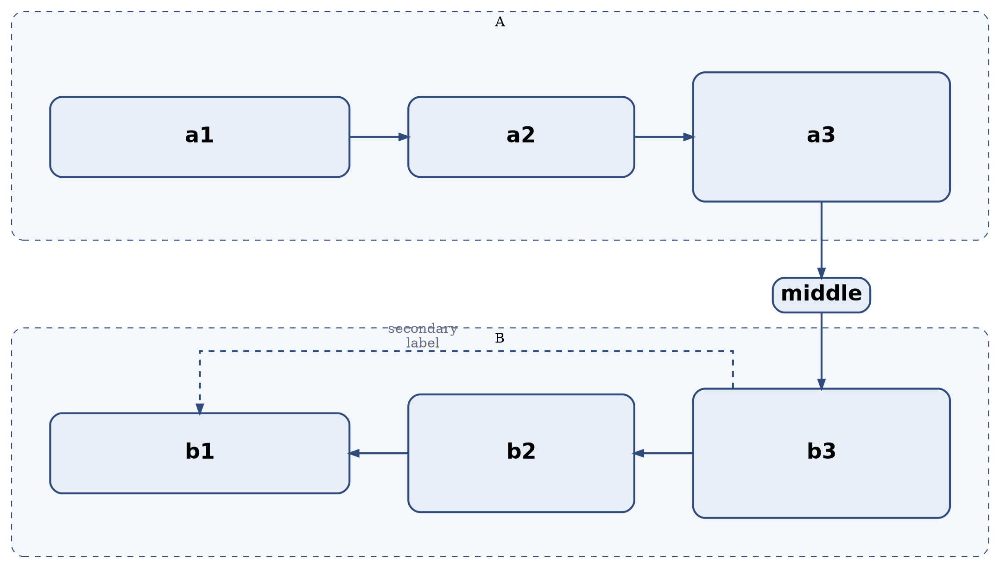

# Graphviz `dot` layout reference

The `dot` engine assigns every node to a **rank** (row when `rankdir=TB`) and
then orders nodes within each rank, routing edges afterward. Understanding those
two phases — **ranking** and **ordering** — is what lets you control a schematic
figure instead of guessing.

Engine is selected with `-K` or the binary name (`dot`, `neato`, …). Everything
below assumes `dot` (and `-Kdot`).

## The basics

| Attribute | Default | Meaning |
| --- | --- | --- |
| `rankdir` | `TB` | rank direction: `TB`, `BT`, `LR`, `RL` |
| `nodesep` | `0.25` | minimum space between nodes in a rank (inches) |
| `ranksep` | `0.5` | space between ranks (inches) |
| `newrank` | `false` | allow `rank=same` to span clusters |
| `compound` | `false` | allow edges to clusters (`lhead`/`ltail`) |
| `splines` | `spline` | edge routing: `spline`, `line`, `polyline`, `ortho`, `curved`, `none` |
| `ordering` | — | `out` / `in`: constrain left-to-right order of edges |
| `pack` / `packmode` | `false` / `node` | pack disconnected components |

## Ranking

An edge `a -> b` normally puts `b` one rank **after** `a` (below, for `TB`).
Ranking ignores, on request:

```dot
a -> b [constraint=false];   // draw the edge, but do not rank by it
```

`constraint=false` is the single most useful attribute for schematic figures:
it lets you draw a *secondary* relation — a notification, an annotation, a
legend link — **without** letting it move the nodes. The edge is still routed
around the graph, but the layout stays as if it did not exist.

Force ranks explicitly:

```dot
{ rank=same;  a; b; c; }   // one row
{ rank=min;   top; }       // first rank
{ rank=max;   bottom; }    // last rank
{ rank=source; s; }        // first rank, even with no incoming edges
{ rank=sink;  t; }         // last rank, even with no outgoing edges
```

`rank=same` is the alignment primitive. With `rankdir=TB` it makes a row; with
`rankdir=LR` it makes a column.

> **Cross-cluster `rank=same` requires `newrank=true`.** Without it you get
> `Warning: X was already in a rankset, deleted from cluster` and the node is
> pulled out of its cluster.

## Ordering within a rank

Rank assignment decides *which row*; ordering decides *left-to-right position*.

- Flat edges (edges whose endpoints share a rank) are ordered by their
  direction: `a -> b` with `a` and `b` on the same rank puts `a` **left** of
  `b`.
- `weight` (default `1`) is a hint: higher weight makes an edge shorter and
  straighter, and strongly influences ordering.
- `ordering=out` forces outgoing edges to fan out in declaration order.
- Declaration order is also a hint, but crossings and weights can override it.

### Mirroring a row (arrows reversed, columns unchanged)

To draw a second row that mirrors the first — same columns, arrows pointing the
other way — write the flat edges **in the order you want the columns**, with
`dir=back` so the arrowhead is drawn at the tail:

```dot
// want:  ejec  |  deser  |  rhc     (left to right)
// arrows:  <-        <-             (flow goes right to left)
{ rank=same; ejec; deser; rhc; }
ejec  -> deser [dir=back];   // orders ejec left of deser, arrow points left
deser -> rhc   [dir=back];   // orders deser left of rhc,  arrow points left
```

Without `dir=back`, `deser -> rhc` would place `deser` left of `rhc` but draw
the arrow pointing **right**, which is the opposite of the intended flow.

### Aligning columns across ranks

There is no "same column" attribute that works on its own. Two reliable ways:

1. **A chain through the column.** If the node in row 1 and the node in row 2
   are connected by edges, the chain tends to straighten:
   ```dot
   top_col3 -> mid_col3 -> bottom_col3 [weight=10];
   // plus group="col3" on all three
   ```
   `group` is a soft hint that propagates along edges; it helps straighten a
   chain but does nothing between unconnected nodes.

2. **Equal row geometry.** Give mirrored nodes the same fixed width and the rows
   the same total width; the columns then line up by construction:
   ```dot
   a [width=4.3, height=1.15, fixedsize=true];
   b [width=3.25, height=1.15, fixedsize=true];
   // ... same widths, in the same order, in the other cluster
   ```
   This is also the only reliable way to make two clusters the same size:
   equal-width rows produce equal-width clusters.

`fixedsize=true` ignores the label when sizing, so choose the width for the
longest label. Verify with `dot -Tplain` (see below).

## Clusters

```dot
subgraph cluster_pub {
  label = "Proceso publicador";
  style = "dashed,rounded,filled";
  fillcolor = "#f4f7fb";
  color = "#2f4b7c";
  penwidth = 2;
  margin = 20;
  // nodes...
}
```

- Cluster border styles combine: `"dashed,rounded,filled"`.
- `margin` is space between the contents and the border. It applies to the
  cluster, not the nodes (node `margin` is padding around the label). A small
  `margin` keeps the box tight; a large one leaves room for labels or edge
  routing and is the usual way to make a cluster enclose something drawn near
  its edge.
- A node belongs to the first cluster it appears in.
- `labeljust=l|r|c`, `labelloc=t|b|c`.
- Cluster size is **computed**. Use equal-width rows to make two clusters the
  same size; do not expect `size`/`ratio` to do it (those affect the drawing,
  not the cluster).

## Edge routing

- `splines=ortho` — right-angle segments. Good for schematics and block
  diagrams. **It does not place edge labels**: it warns and skips them. Use
  `xlabel` (external label) for edge text under `ortho`.
- `splines=polyline` — straight segments with bends; supports labels.
- `splines=spline` (default) — smooth curves; best for general graphs.
- `splines=curved` — rounded curves; can look loose in dense graphs.
- `splines=none` — straight lines, no routing.
- `label`, `xlabel`, `headlabel`, `taillabel` are different label kinds;
  `xlabel` is not part of the edge geometry and is the safe choice when the
  router cannot place a label.

Ports give the router a side to attach to:

```dot
a:s -> b:n         // south side of a to north side of b
a:w -> b:e
```

Compass points: `n`, `ne`, `e`, `se`, `s`, `sw`, `w`, `nw`, `c`, `_`. Ports
constrain the endpoint, not the route.

## Verifying the geometry

`dot -Tplain` prints the laid-out graph in inches (origin bottom-left, y grows
up). Format:

```text
graph <scale> <width> <height>
node <name> <x> <y> <width> <height> <label> <style> <shape> <color> <fillcolor>
edge <tail> <head> <n> <x1> <y1> ... <xn> <yn> [label] [style] [color]
stop
```

Useful checks:

```sh
# node centres, to confirm columns/rows line up
dot -Tplain f.dot | awk '$1=="node"{printf "%-12s x=%8.4f y=%8.4f\n",$2,$3,$4}'

# machine-readable geometry
dot -Tjson f.dot | jq '.objects[] | {name, pos}'

# resolved defaults (what Graphviz actually used)
dot -Tcanon f.dot
```

`-Tplain` reports **centre** coordinates. Two nodes with the same `x` share a
column; two nodes with the same `y` share a row.

## Practical recipe: a mirrored, column-aligned two-cluster figure


