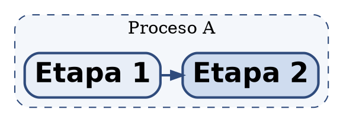

# Graphviz DOT syntax reference

Verified against Graphviz 16.1.0. If `dot -V` differs, re-verify the probes.

## Graph kinds

```dot
digraph  G { ... }   // directed graph (a -> b)
graph    G { ... }   // undirected graph (a -- b)
strict digraph G { } // collapse parallel edges into one
```

- `->` is an edge in a `digraph`; `--` in a `graph`. Mixing them is an error.
- `strict` disallows multi-edges and self-loops (self-loops are allowed in
  non-strict graphs).

## Statements

A file is a sequence of statements, each terminated by `;` or a newline:

```dot
digraph G {
  graph [rankdir=TB];          // default graph attributes
  node  [shape=box];           // default node attributes
  edge  [color="#2f4b7c"];     // default edge attributes

  a [label="One"];             // node statement
  b [label="Two"];

  a -> b [penwidth=2];         // edge statement
}
```



- Attribute values use `name=value`; separate several with commas:
  `a [shape=box, style=filled, fillcolor="#eee"]`.
- `name="value"` needs quotes for spaces/punctuation; simple identifiers and
  numbers need none.
- Later assignments override earlier ones. Graph defaults apply to nodes/edges
  declared **after** them (and to the whole graph for `graph [...]`).

## IDs

An ID is one of:

- an alphanumeric identifier (`node_1`; must not start with a digit),
- a numeral (`3`, `-2.5`),
- a double-quoted string (`"with spaces"`, `"a->b"`),
- an HTML-like string (`<B>bold</B>`).

Quote anything containing whitespace or punctuation. Keys/IDs are
case-sensitive.

## Comments

```dot
// line comment
/* block
   comment */
# a line starting with # is a preprocessor line marker, ignored
```

`#` is **not** a comment mid-line — quote a label that contains it.

## Nodes

```dot
a;                          // ID a, default shape (ellipse)
a [label="Label"];          // attributes
a [label="line1\nline2"];   // multi-line label
```

Declaring an edge also declares its endpoints. A node appears once; later
statements add/override attributes. `\N` in a label expands to the node's name.

### Ports

Attach an edge to a side/port of a node:

```dot
a:n -> b:s            // compass points: n, ne, e, se, s, sw, w, nw, c, _
a:port1 -> b          // named port declared with the node's `shapefile`/`port`
```

Also available as edge attributes `tailport` / `headport`, and for record/HTML
shapes as `tailport="name:port"`.

## Edges

```dot
a -> b;
a -> b -> c;                     // chain
{ a b } -> { c d };              // edge set (all pairs)
a -> b [label="x", constraint=false];
```

- `dir=forward|back|both|none` controls arrowheads (`back` puts it at the tail).
- `arrowhead` / `arrowtail` choose the shape; `arrowsize` scales it.
- Edge attributes can be set globally with `edge [...]`.

## Attribute scope

Four scopes, in increasing specificity:

```dot
graph [ ... ]   // whole graph (and cluster when inside a subgraph)
node  [ ... ]   // defaults for nodes declared after it
edge  [ ... ]   // defaults for edges declared after it
a [ ... ]       // that object only
```

Cluster attributes are graph attributes inside `subgraph cluster_*`.

## Subgraphs and clusters

Namespace subgraphs (no border, no fill):

```dot
subgraph sg { a; b; }
```

Clusters (drawn as a bordered region) require the name to start with
`cluster_`:

```dot
subgraph cluster_pub {
  label = "Proceso publicador";
  style = "dashed,rounded,filled";
  fillcolor = "#f4f7fb";
  color = "#2f4b7c";
  margin = 20;
  a; b;
}
```

- A node belongs to the **first** cluster it appears in.
- Cluster labels support `labeljust` (`l`/`r`/`c`) and `labelloc` (`t`/`b`/`c`).
- `compound=true` plus `lhead`/`ltail` on an edge lets an edge point at a
  cluster as a whole.
- `rank=same` that spans clusters needs `newrank=true` (see
  `references/layout.md`).

## Labels and text

- `\n` centred line break, `\l` left, `\r` right (the last line's alignment is
  set by the break character).
- Escapes: `\"` quote, `\\` backslash.
- Substitutions in labels: `\N` (node name), `\G` (graph name), `\E` (edge
  name), `\T` (tail), `\H` (head), `\L` (object label).
- **HTML-like labels** start with `<` and end with `>`:

  ```dot
  a [label=<
    <TABLE BORDER="0" CELLBORDER="1">
      <TR><TD><B>bold</B></TD></TR>
    </TABLE>
  >];
  ```

  Inside HTML labels use `<BR/>`, `<B>`, `<I>`, `<FONT COLOR="...">`,
  `<TABLE>`; `&amp;`, `&lt;`, `&gt;` for special characters.

## Text encoding

Files are UTF-8. Graphviz renders whatever glyphs the selected font contains;
`→`, `×`, accented Spanish letters are fine with e.g. `DejaVu Sans`. If a glyph
renders as a box, change `fontname` — it is a font issue, not a syntax issue.

## Minimal complete example


